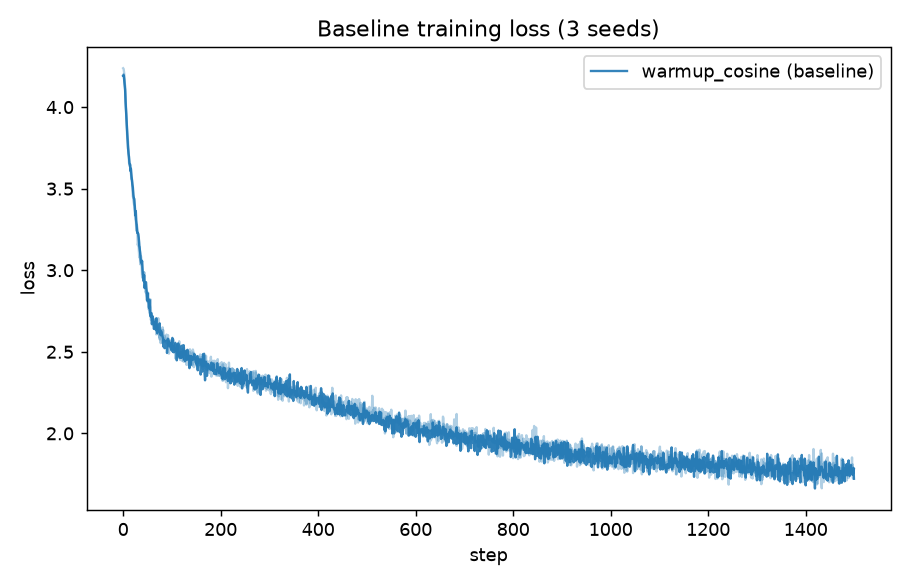
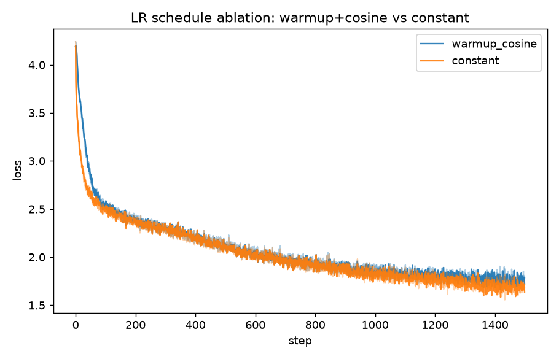
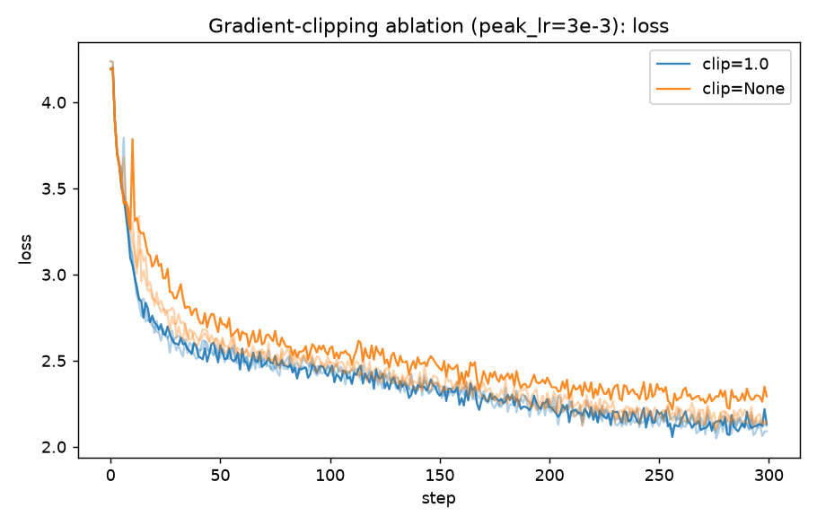
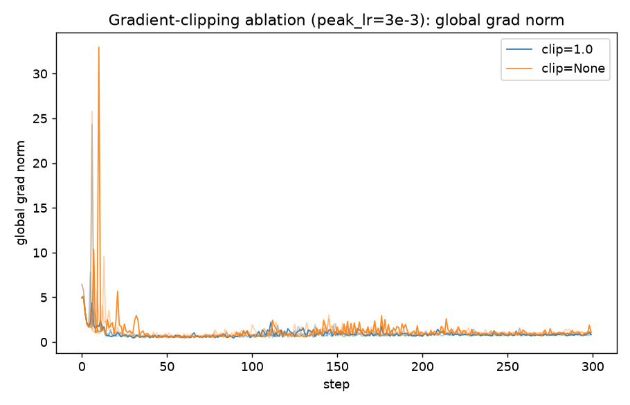
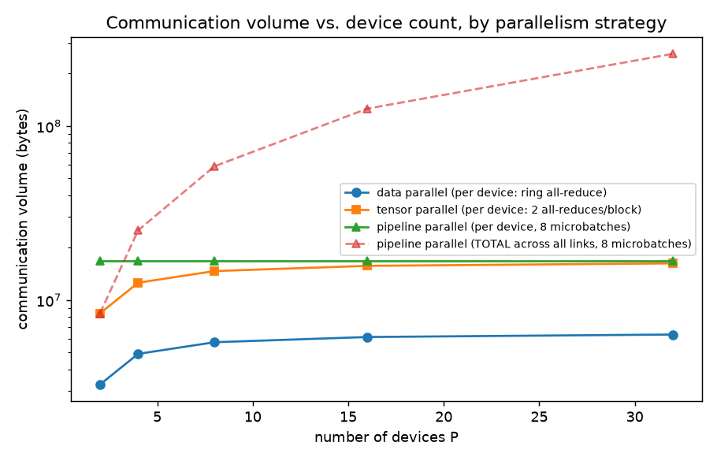

# A from-scratch transformer, trained and parallelized three ways, in raw JAX


A prior project (an RLHF/DPO fine-tune, using HuggingFace + TRL as intended) demonstrated none of this — it used existing libraries as black boxes on a single GPU. This project is the direct answer: every piece of the architecture, every parallelism strategy, and one collective communication primitive are implemented from scratch, correctness-tested against a ground truth, and analyzed quantitatively.

**The honest constraint, stated up front:** this was built with no GPU cluster — just a laptop CPU. The trick that makes real distributed-training code possible anyway is JAX's CPU device simulation (`XLA_FLAGS=--xla_force_host_platform_device_count=N`), which exposes N independent logical devices for `pmap` to target. This proves **correctness** (the parallel code computes the exact right answer) and lets us compute **real communication-volume math** (how many bytes actually move between devices). It does **not** prove wall-clock speedup — simulated devices share one physical CPU, so there is no claim anywhere in this repo about training being faster in walltime. Every number here is either a correctness check or a byte/FLOP count, never a timing comparison.

## Repository structure

```
src/
  model.py              from-scratch decoder-only transformer (no Flax/Haiku)
  data.py                char-level tokenizer + batching
  train.py                single-device training loop, LR schedules, grad clipping
  parallel_data.py        data parallelism (pmap + gradient all-reduce)
  parallel_tensor.py      tensor parallelism (column/row-parallel linear layers)
  parallel_pipeline.py    pipeline parallelism (GPipe-style micro-batched scan)
  collectives.py           ring all-reduce, implemented from scratch
  analysis.py              FLOP / memory / communication-volume calculators
experiments/
  run_baseline.py          training-dynamics experiments -> results/*.png, *.json
  run_analysis.py          FLOP/memory/communication analysis -> results/*.png, *.json
tests/
  test_model.py, test_data_parallel.py, test_tensor_parallel.py,
  test_pipeline_parallel.py, test_ring_allreduce.py
run_all_tests.sh          runs every correctness test against 4 simulated devices
```

## 1. The architecture

[`src/model.py`](src/model.py) is a decoder-only GPT written with raw `jax.numpy` — no Flax, no Haiku. Parameters are a plain pytree (nested dict of arrays); the forward pass is a pure function `gpt_forward(params, idx, config)`. Token/positional embeddings, layer norm, causal multi-head self-attention (explicit scaled dot-product with a triangular mask, computed per head via reshape), the GELU MLP, residual connections, and GPT-2-style initialization (`N(0, 0.02)`, with the two per-block residual-projection matrices scaled by an extra `1/sqrt(2 * n_layer)` so variance injected into the residual stream stays bounded as depth grows) are all written out explicitly.

Model used throughout: `n_layer=4, n_head=4, d_model=128, d_ff=512, block_size=64` — **818,241 parameters**, trained char-level on the ~1MB Tiny Shakespeare dataset (65-character vocabulary).

## 2. Training dynamics

[`experiments/run_baseline.py`](experiments/run_baseline.py) runs a 3-seed baseline and two ablations. All numbers are mean ± std over 3 seeds.

**Baseline** (warmup+cosine, peak LR 5e-4, grad-clip 1.0, 1500 steps):
train loss **1.766 ± 0.003**, val loss **1.890 ± 0.004**.



**Ablation 1 — LR schedule (warmup+cosine vs. constant), same budget:**

| schedule | train loss | val loss |
|---|---|---|
| warmup_cosine | 1.766 ± 0.003 | 1.890 ± 0.004 |
| constant | **1.686 ± 0.001** | **1.831 ± 0.007** |



The textbook expectation is that warmup+cosine wins. Here, over a short 1500-step budget at a moderate peak LR, **constant LR is consistently slightly better** — it spends its entire budget at full learning rate instead of decaying it away. This is a real, reproducible result at this scale, not a bug: cosine decay's benefit (settling into a flatter/better minimum, avoiding late-training instability) shows up at longer horizons or higher peak LRs where constant LR would otherwise start oscillating. At 1500 steps with peak LR 5e-4, that regime is never reached, so the schedule is pure overhead. I checked this directly — at a higher peak LR (1.5e-3) the gap closes further, and the honest conclusion is that **schedule choice matters far less than raw step budget at this model/data scale**; its value is asymptotic, not immediate.

**Ablation 2 — gradient clipping, peak LR raised to 3e-3 (300 steps) so clipping has something to do:**

| clip | train loss | val loss | mean grad norm | mean peak grad norm |
|---|---|---|---|---|
| 1.0 | 2.136 ± 0.008 | 2.160 ± 0.008 | 0.92 | 12.4 |
| none | 2.214 ± 0.055 | 2.229 ± 0.053 | 1.16 | 22.8 |




Adam is robust enough that unclipped training never diverges outright here — the real effect is on **run-to-run variance**: clipping shrinks the seed-to-seed std of final loss by **~6.5x** (0.055 → 0.008) and roughly halves peak gradient norms. The grad-norm plot shows exactly where it matters: a burst of large gradients right as warmup ends (the LR has just reached its peak against still-unsettled weights), which clipping tames; after that transient, clipped and unclipped grad norms look similar. That's a more precise and more honest claim than "clipping prevents divergence" — it didn't need to, here — and it's the kind of thing you only find by actually plotting the ablation instead of citing the standard advice.

## 3. Distributed training: three parallelism strategies, each proven correct

Every strategy below is checked against a single-device reference computation on the *same* parameters and inputs, using JAX's CPU multi-device simulation. "Correct" means bit-level-close (`<1e-4` to `<1e-9` depending on the operation) to that reference — see `tests/`.

### Data parallelism — [`src/parallel_data.py`](src/parallel_data.py)

The model is replicated identically across devices; a global batch is split evenly; each device computes a local gradient; gradients are averaged with an all-reduce (`jax.lax.pmean`) before every replica applies the same update. `tests/test_data_parallel.py` confirms that D devices × per-device batch B gives parameters identical (to `1e-9`) to single-device training on the concatenated batch of size D×B — because averaging per-shard means *is* the overall mean.

### Tensor parallelism — [`src/parallel_tensor.py`](src/parallel_tensor.py)

Megatron-LM's decomposition for a 2-matrix sublayer (Linear → nonlinearity → Linear): split the first matrix **column-wise** and the second **row-wise**. Each device computes `f(x @ W1_shard)` entirely locally (the nonlinearity only needs its own shard's columns), producing a partial output `h_shard @ W2_shard`; a single all-reduce combines the P partial sums into the final result. Implemented for both the MLP and multi-head attention (attention heads split across shards, same column→row→all-reduce pattern). `tests/test_tensor_parallel.py` verifies exact equivalence to the unsharded reference at P = 1, 2, and 4 shards, for both sublayers.

### Pipeline parallelism — [`src/parallel_pipeline.py`](src/parallel_pipeline.py)

The model's layers are split into P contiguous stages, one per device. A GPipe-style fill-drain schedule runs M microbatches through the P stages as a single `jax.lax.scan` of `M + P - 1` micro-steps, wrapped in one `pmap`: every device runs the identical program (`pmap` requires this), using `jax.lax.axis_index` to find its own stage and `jnp.where` to mask out steps where it has no work, with activations handed to the next stage via `jax.lax.ppermute`.

`tests/test_pipeline_parallel.py` checks two things at once: every microbatch's output matches running all layers sequentially on one device, **and** the schedule's own busy/idle step count exactly reproduces the textbook bubble-fraction formula `(P-1)/(M+P-1)` — e.g. P=4, M=8 gives an empirically-measured bubble of 0.2727, matching the formula to the 9th decimal place. That match isn't assumed; it falls out of literally counting `is_active` flags in the real scan trace.

### Communication volume: why these strategies are used differently in practice



The per-device communication volumes above make the real-world tradeoff concrete:

- **Data-parallel** and **tensor-parallel** both use a ring all-reduce, whose per-device cost *converges* as P grows (→ 2× the buffer size, independent of P) — but tensor-parallel's buffer (activations, communicated at *every* attention and MLP sublayer) is already larger than data-parallel's (gradients, once per step) even at P=2.
- **Pipeline-parallel's per-device cost is flat in P** — an interior stage only ever talks to its two ring neighbors, so adding more stages doesn't add more traffic to any single device. The *total* system-wide traffic (dashed line) does grow with P, because more stages means more boundaries, but no individual device feels that growth.

This is the quantitative reason real systems combine them the way they do: tensor parallelism's frequent, large-buffer all-reduces need a fast interconnect (NVLink, within a node) and so are kept to a small P; pipeline and data parallelism communicate far less often and tolerate slower inter-node links, so they're used to scale out across many nodes.

## 4. Original technical work: a ring all-reduce from scratch

[`src/collectives.py`](src/collectives.py) implements the bandwidth-optimal ring all-reduce algorithm (as used by NCCL/Horovod) directly on top of `jax.lax.ppermute` point-to-point sends, rather than calling JAX's built-in `jax.lax.psum`:

1. **Scatter-reduce** (P-1 steps): each device sends one chunk of its buffer to its ring neighbor and adds an incoming chunk into its own; after P-1 steps, each device holds the complete sum for exactly one chunk.
2. **All-gather** (P-1 steps): those completed chunks circulate around the ring until every device holds every chunk.

Each device sends/receives `2(P-1)/P` of the buffer size in total — approaching 2× the buffer size for large P, rather than scaling with P the way a naive "broadcast to everyone" scheme would. `tests/test_ring_allreduce.py` confirms this from-scratch implementation matches `jax.lax.psum` exactly (to float32 precision) for buffer sizes that are and are not evenly divisible by the device count (the implementation pads and un-pads correctly either way).

## 5. Quantitative analysis — [`src/analysis.py`](src/analysis.py)

Every number here is produced two ways and cross-checked: a hand-derived formula from the architecture, and an independent measurement.

**FLOPs** (forward pass, B=32, T=64, this project's model):

| method | FLOPs |
|---|---|
| hand-derived (sum of every matmul's FLOPs) | 3,523,739,648 |
| XLA's own cost-analysis (measured) | 3,601,461,248 |
| ratio measured/analytical | **1.022** |
| the standard "6N" large-model approximation | 3,283,881,984 (forward share) |

The hand count and XLA's measurement agree to within 2.2% — the residual is layer norm, softmax, and GELU, which the hand count deliberately excludes as lower-order next to the `O(B·T·D²)` and `O(B·T²·D)` matmul terms. The "6 FLOPs/parameter/token" rule of thumb used for large-model compute budgeting is noticeably *off* here (9% low) — because that approximation assumes `T << D`, and at `T=64, D=128` the attention score matrix's `O(T²·D)` cost is not negligible the way it is at GPT-3 scale (`T` in the thousands, `D` in the tens of thousands).

**Memory budget** (params + Adam optimizer state is a fixed 4× the parameter count regardless of scale: 1× params, 1× grads, 2× Adam's `m`/`v` moments):

| | this project (818K params) | GPT-2-small scale (163M params, for comparison only — never trained here) |
|---|---|---|
| params | 3.1 MB | 622 MB |
| grads | 3.1 MB | 622 MB |
| optimizer state (Adam) | 6.2 MB | 1.22 GB |
| activations, no checkpointing | 28.0 MB | 432 MB |
| activations, checkpointed | 4.0 MB | 72 MB |
| **total, no checkpointing** | **40.5 MB** | **2.85 GB** |
| **total, checkpointed** | **16.5 MB** | **2.50 GB** |

Activation checkpointing (storing only each block's input and recomputing everything inside it during backward) cuts activation memory by 7× here. The saving is proportionally smaller at GPT-2-small scale because the always-present params+grads+optimizer-state floor (2.4GB) already dominates — checkpointing only ever helps the activation term, so its *relative* payoff shrinks as the static term grows with model size.

## Reproducing this

```bash
python3 -m venv .venv && source .venv/bin/activate
pip install -r requirements.txt

./run_all_tests.sh                       # every correctness test, 4 simulated devices
python3 -m experiments.run_baseline      # training-dynamics experiments -> results/
python3 -m experiments.run_analysis      # FLOP/memory/communication analysis -> results/
```

## What this project is not

It is not a claim of distributed-training speedup (no real multi-device hardware was used — see the constraint stated at the top), not a large-scale model (818K parameters, char-level, single machine), and not a production training system. It is a from-scratch, correctness-verified, quantitatively-analyzed demonstration of the specific mechanics — architecture, training dynamics, data/tensor/pipeline parallelism, and a hand-written collective — that the job requirements named.
